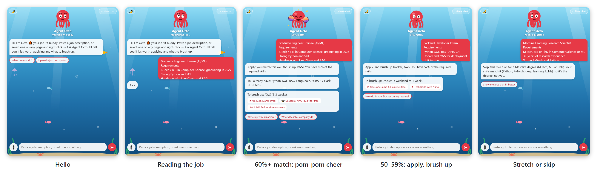
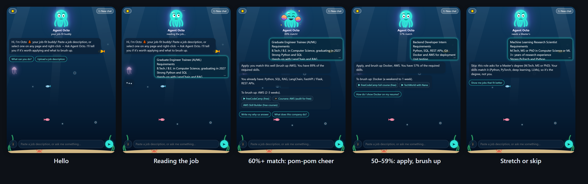
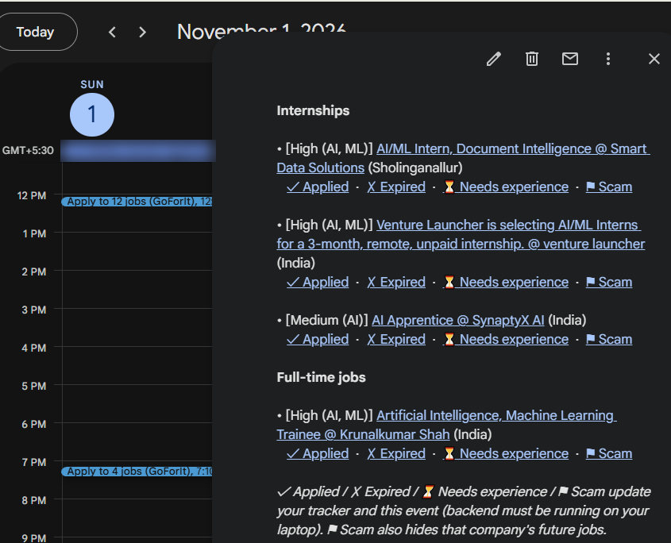
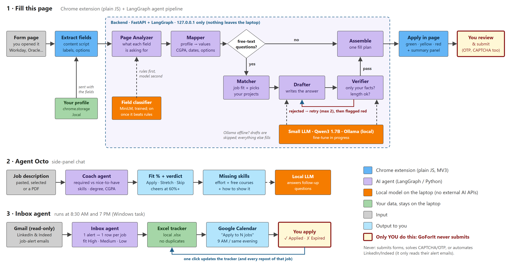

# Go For It, Agent

*Tired of retyping the same details on every job application?*

**GoForIt** is a personal project that uses AI agents to simplify the job and campus-placement application process. It helps autofill application forms, organize LinkedIn and Indeed job alerts, and evaluate how well an opportunity matches your profile.

Meet **Agent Octo 🐙**, your job-fit companion. It analyzes job requirements against your skills, identifies potential skill gaps, and points you towards free courses to help you bridge them.

The idea is simple: spend less time on repetitive applications and more time finding the right opportunities.

> **You're always in control.** GoForIt assists with form filling and job discovery, but never submits an application on your behalf. You review everything and make the final call.

**Note:** GoForIt is a personal project and is not available as a hosted or deployed service. To try it, clone the repository and run it locally. The current implementation uses Ollama for local LLM inference. The AI integration can also be adapted to other providers, such as Claude or ChatGPT, by modifying the relevant components and configuring your own API access. External provider usage may incur costs.

---

## Objectives

- **Simplify applications:** Reduce repetitive data entry across job and campus-placement application forms.
- **Smarter form detection:** Identify and classify form fields to determine what information they require.
- **Job discovery:** Organize job opportunities received through LinkedIn and Indeed email alerts.
- **Job-fit analysis:** Evaluate opportunities against the user's profile, qualifications, and skills.
- **Skill gap identification:** Highlight missing or relevant skills and recommend free learning resources.
- **User-controlled automation:** Assist with repetitive tasks while keeping application review and submission entirely in the user's hands.

---

## Methodology

GoForIt combines a Chrome extension, a local Python backend, and an agent-based workflow coordinated through LangGraph.

### 1. Profile Management

Users provide their personal, academic, and professional information through the Chrome extension. Profile data is stored locally using `chrome.storage.local`.

### 2. Form Detection and Classification

When the user selects **Fill this page**, the extension identifies available form fields. A fine-tuned field classifier predicts the purpose of each field and helps map it to the corresponding information in the user's profile.

### 3. Agent-Based Form Filling

A LangGraph pipeline coordinates the AI agents involved in processing application forms. A small LLM served through Ollama supports language-based tasks, while the field classifier assists with identifying relevant information.

The system uses the user's stored profile to populate corresponding fields.

### 4. Job Alert Scanning

GoForIt includes a daily job-alert scanning workflow for LinkedIn and Indeed notifications. Relevant opportunities are organized into an Excel file and can be linked with Google Calendar for tracking.

### 5. Job-Fit Analysis with Agent Octo

Agent Octo evaluates job requirements against the user's profile to estimate how well an opportunity matches their qualifications and skills.

It also identifies potential skill gaps and provides links to relevant free courses to help users improve their suitability for future opportunities.

### 6. Review and Submission

Filled fields receive visual indicators to help users review the results:

- **Green:** Information successfully filled.
- **Yellow:** Information requires review.
- **Red:** Information is missing.

GoForIt never submits applications automatically. Users review the information and submit applications themselves.

---

## Demo

Want to see GoForIt in action?

The demo walks through the application's workflow, including form filling, job-alert scanning, and Agent Octo's job-fit analysis.

**[▶ Watch the GoForIt Demo](https://drive.google.com/file/d/1RGAL4Xed6XN2D8UmwhgOHOc2k5uhEQmH/view?usp=drive_link)**

---

## Output & Results

A look at GoForIt in action.

### 1. Chrome Extension

The extension provides access to profile management and the application's main features.


### 2. Automated Form Filling

GoForIt uses the saved profile to populate relevant fields on supported application forms.


### 3. Field Classification and Review

The field classifier identifies the information requested by each form field. Visual indicators help distinguish successfully filled fields from fields that need attention.

<table>
  <tr>
    <td align="center">
      
    </td>
    <td align="center">
      
    </td>
  </tr>
</table>

### 4. Job Alert Scanning

Daily scanning of job notifications received through LinkedIn and Indeed, organized for easier tracking.


**Five weeks of daily use (25 Sep – 1 Nov 2026):**

| Metric | Count |
|---|---|
| Jobs tracked from alert emails | 1,103 (756 LinkedIn · 347 Indeed) |
| High fit | 180 |
| Medium fit | 388 |
| Low fit | 535 |
| Added to calendar reminders | 592 |
| Flagged as scam | 6 |
| Needs more experience | 4 |
| Expired before applying | 43 |

### 5. Job-Fit Analysis — Agent Octo

Agent Octo 🐙 evaluates job requirements against the user's profile and provides a job-fit assessment. It encourages the user to apply if the JD requirements and the profile match well (it cheers with pom-poms at a 60%+ match), points out the missing skills with free courses to learn them, and says "skip" when a hard requirement such as a Master's degree isn't met. It works in both a day and a night sea.



<details><summary>Night mode</summary>


</details>


### 6. Apply Reminders — Google Calendar

High-fit and Medium-fit jobs from the alert emails become one "Apply to N jobs" reminder: at 9 AM for jobs that arrived overnight, and about 10 minutes after the 7 PM scan for jobs that came in during the day (popular LinkedIn posts often close within a day). Jobs are grouped into internships and full-time roles, best fit first. One click on ✓ Applied, ✗ Expired, ⏳ Needs experience or ⚑ Scam updates the Excel tracker and the event; ⚑ Scam also hides that company's future jobs.

<p align="center">
  
</p>


---

## Getting Started

GoForIt runs locally and requires a Python backend and a Chrome extension.

### Prerequisites

- Python 3.11
- Google Chrome
- Ollama
- Git

### 1. Clone the Repository

```bash
git clone YOUR_REPOSITORY_URL
cd GoForIt
```

### 2. Backend Setup

Navigate to the backend directory:

```powershell
cd backend
```

Create and activate a virtual environment:

```powershell
py -3.11 -m venv .venv
.venv\Scripts\activate
```

Install the required dependencies:

```powershell
pip install -r requirements.txt
```

Start the backend:

```powershell
python -m app.main
```

The backend should be available at:

`http://127.0.0.1:8000`

Check its status by opening:

`http://127.0.0.1:8000/health`

Make sure Ollama is installed, running, and configured with the model required by the project.

### 3. Configure the Chrome Extension

1. Open `chrome://extensions`.
2. Enable **Developer mode**.
3. Click **Load unpacked**.
4. Select the `extension/` directory.
5. Click the GoForIt icon.
6. Select **Edit profile** and enter your information.
7. Open a supported application form and select **Fill this page**.

Your profile information is stored locally using `chrome.storage.local`.

### 4. Try the Demo Portal

Open `demo-site/index.html` to explore the fictional **Ostania Tech** application portal.

You can also import the sample profile:

`docs/demo/anya-forger-demo.json`

For offline test forms, refer to:

`test-forms/README.md`

---

## Job Alerts

GoForIt also includes a scheduled job-scanning workflow.

- **Automatic scan:** `install-daily-scan.ps1` registers a Windows scheduled task that runs daily at 8:30 AM.
- **Manual scan:** Run `check-jobs.bat` to trigger a scan manually.
- **Logs:** Available at `Documents\GoForIt\inbox-log.txt`.
- **Calendar integration:** Start the backend using `start-backend.bat` for the application tracking links.

The job-alert workflow uses the configured integrations and requires the relevant access and authentication. The scheduled task is intended for Windows environments.

---

## Testing

GoForIt includes tests for its Chrome extension, backend, and form-filling workflow.

Run the following commands from the repository root:

```bash
# Extension unit tests
node --test "extension/tests/*.test.js"

# Headless Chrome form-filling tests
node extension/tests/run-harness.js

# Backend tests
pytest
```

---

## Architecture

The project combines browser-side form interaction with local AI processing and supporting job-alert workflows.

### Core Components

| Component | Technology |
|---|---|
| Browser extension | JavaScript, Chrome Extension APIs |
| Backend | Python, FastAPI |
| Agent orchestration | LangGraph |
| Local LLM | Ollama |
| Field classification | Fine-tuned ML classifier |
| Job-alert workflow | Python, Excel, Google Calendar integration |

For additional implementation details, refer to the project documentation:

- [Safety Rules](docs/RULES.md)
- [Project Metrics](docs/METRICS.md)

---

## Limitations & Future Improvements

GoForIt is an ongoing personal project. Some components are still being refined.

Areas of continued development include:

- Improving field classification accuracy across different application platforms.
- Further fine-tuning the field classification model.
- Improving job-fit assessment and skill-gap identification.
- Expanding support for different application form structures.
- Exploring additional LLM integrations.

---

## Safety & Privacy

GoForIt is designed as an assistant, not an autonomous job-application bot.

- Applications are never submitted automatically.
- CAPTCHA solving is not supported.
- The project does not operate as a job-board bot.
- Profile information is stored locally in the Chrome extension.
- Local LLM inference is used in the current form-filling workflow.

Users are responsible for reviewing the information and deciding what to submit.

---

## Credits & Disclaimer

- **Character:** Anya Forger from *SPY×FAMILY*, created by Tatsuya Endo and published by Shueisha.
- **Artwork inspiration:** The illustration used in the demo resume is fan art hand-drawn by me.
- **Demo data:** The resume uses fictional personal, academic, and professional details created solely for demonstration and testing.

*SPY×FAMILY*, its characters, names, and associated intellectual property belong to their respective rights holders. GoForIt is an independent personal project and is not affiliated with, endorsed by, or sponsored by Tatsuya Endo, Shueisha, or the rights holders.

