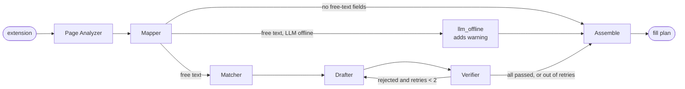

# Agents

`POST /run-fill` runs a LangGraph pipeline (`backend/agents/graph.py`). The extension sends field descriptors (no DOM) plus the profile, and gets back one **FillAction** per field: `{field_id, key, status, value, reason, source}`, where status is `filled | review | missing | skipped`.

## Graph



Every node appends its name to `trace`, which is returned in the response so the path can be checked and demoed.

## Agents

| Agent | Status | Input | Output |
|---|---|---|---|
| **Page Analyzer** (`page_analyzer.py`) | rules (`services/rules.py`); classifier in Phase 6 | `fields` | `classified` (key per field), `free_text_fields` |
| **Mapper** (`mapper.py`) | done | `classified`, `profile` | `fill_plan`. Value lookup and formatting (dates, 10-digit phones, month/year), CGPA scale conversion (flagged), option choice via `services/option_match.py` (synonyms, numeric ranges, branch + specialization). Never invents values. |
| **Matcher** (`matcher.py`) | keyword version (embeddings in Phase 9) | job description + questions, non-sensitive profile | `fit`: score, matched skills, best projects ranked by shared tech (x2) and shared keywords |
| **Drafter** (`drafter.py`) | template version (LLM in Phase 8/9) | free-text fields, Matcher picks | `drafts`: motivation ("Why join X?") and project answers built only from profile facts; shorter on retry |
| **Verifier** (`verifier.py`) | rule checks (LLM judge in Phase 9) | `drafts`, profile facts | `verification`: rejects drafts that are too long or mention numbers/technologies not in the profile |
| **Assemble** (`graph.py`) | done | everything | final `actions`: Mapper output, with free-text fields replaced by verified drafts (yellow) or flagged red after 2 failed retries |
| **Tracker** | Phase 10 | | |

## Routing and fallbacks

- **No free-text fields:** Mapper goes straight to Assemble.
- **LLM unavailable** (`services/ollama_client.is_available()`): skip Matcher/Drafter/Verifier, add a warning, and still fill standard fields. In Phase 3 the stub LLM always counts as available.
- **Verifier rejects a draft:** the Drafter rewrites only that field, up to `MAX_DRAFT_RETRIES = 2`. Still rejected after that: the field is left empty and flagged red, with the Verifier's reasons.
- **Backend down:** the extension's background worker can't reach `/run-fill`. The panel shows how to start the backend and **nothing on the page is changed**.
- **Never on the page side:** submitting, clicking Next, ticking consent boxes, or overwriting a field that already has a value.

## Where things live

- Extension → backend: `content.js` → `chrome.runtime.sendMessage` → `background.js` (adds the profile) → `POST http://127.0.0.1:8000/run-fill`.
- The profile is never logged. `app/routes/run_fill.py` logs only the field count and the agent path; a test checks this.
- Only `services/profile_facts.safe_profile()` reaches the Matcher, Drafter and Verifier: education, skills, projects, experience, certifications, languages. Never contact details (tested).
- Tests: `backend/tests/test_graph.py` covers every route above, with the Drafter/Verifier swapped for fakes; `test_drafting.py` covers the real Matcher/Drafter/Verifier.

## AI drafts after Fill (POST /draft, added 2026-10-18)

Fill (`POST /run-fill`) stays fast: rules, Mapper and evidence engine fill every normal field, and open questions get the template draft or "write it yourself". Its reply lists `draftable` field ids (open questions, empty "strengths"/"about me"). If the popup's **"AI drafts"** switch is on, the extension then calls `POST /draft` once per draftable question, and the backend runs a small sub-graph with the local LLM:

```
matcher -> drafter -> verifier --(rejected, retries left: reasons fed back)--> drafter
                              \--> assemble
```

- **Drafter:** local LLM (Qwen3 1.7B by default) writes from the non-sensitive profile, the job description and the Matcher's picks; "NO_DRAFT" when the profile has nothing relevant.
- **Verifier:** rule checks (length, invented numbers, invented concrete tools) + a judge model (Qwen3 1.7B) whose claims only count if they name something checkable that isn't in the profile. Honest negations ("I haven't...") pass.
- Each draft is written only into a box that is still empty (or still holds GoForIt's template); anything the student typed is kept. Drafts are yellow: "AI draft from your profile: check every sentence".
- Ollama off: `/draft` answers "Local AI isn't running: write this one yourself"; Fill is unaffected.
